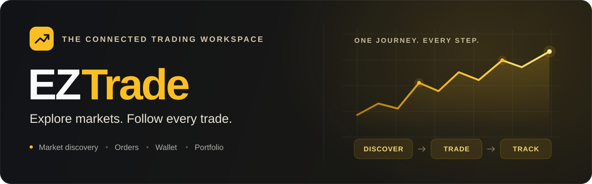
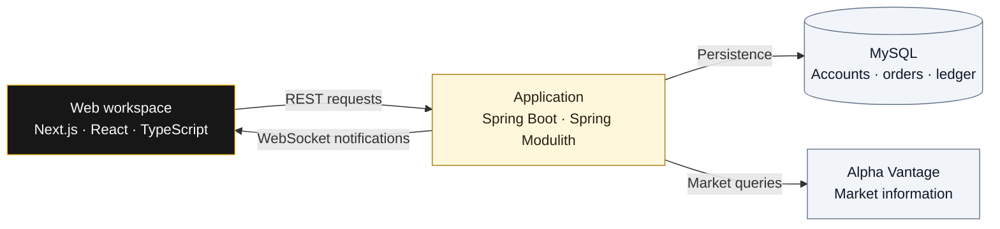

<p align="center">
  
</p>

<h1 align="center">Your trading journey, connected.</h1>

<p align="center">
  Discover instruments, manage orders, and follow your cash and positions<br>
  in one full-stack trading workspace.
</p>

<p align="center">
  <a href="https://github.com/SergioGarciaRuiz557/EZTrade/actions/workflows/maven.yml"></a>
  
  
  
</p>

<p align="center">
  <a href="#the-experience"><strong>Explore the experience</strong></a> ·
  <a href="#run-it-locally"><strong>Run locally</strong></a> ·
  <a href="#your-first-trade"><strong>Try a trade</strong></a> ·
  <a href="#under-the-hood"><strong>See the architecture</strong></a> ·
  <a href="#explore-the-project"><strong>Browse the docs</strong></a>
</p>

---

## The experience

Trading is a sequence of connected decisions: find an instrument, place an order, manage the funds behind it, and understand the resulting position. **EZTrade brings that journey together** with a responsive interface, a marketplace for user sell offers, and a traceable wallet ledger.

The project also makes those connections visible in the code: business modules own their responsibilities and communicate through events. It is a working product demo and an explorable example of full-stack application design.

| In your workspace | What you can do |
| :--- | :--- |
| **🔎 Market discovery** | Search by symbol or company name and inspect quotes and company fundamentals from Alpha Vantage. |
| **📈 Order management** | Create buy orders, reserve funds, and execute or cancel pending orders. |
| **🤝 User marketplace** | Publish sell offers from your holdings and browse offers from other users. |
| **💳 Wallet & ledger** | Add demo funds, withdraw balances, transfer between users, and review transaction history. |
| **📊 Portfolio overview** | Follow holdings, average costs, realized profit and loss, available cash, and recent orders. |
| **🔔 Activity notifications** | Receive account updates in the browser through authenticated WebSocket connections. |

> **Demo scope:** EZTrade runs locally with simulated funds. Market information comes from Alpha Vantage; payments and orders are handled within the application, without bank or brokerage connectivity.

## Run it locally

You need **Git** and **Docker with Docker Compose** running. Docker provides the application runtimes and database, so the Docker route does not require a local Java or Node.js installation.

**1. Get the project**

```bash
git clone https://github.com/SergioGarciaRuiz557/EZTrade.git
cd EZTrade
```

Already have the repository? Open its root directory, where `docker-compose.yml` lives.

**2. Create your local configuration**

If you do not already have a `.env` file, copy the example. On macOS or Linux:

```bash
cp .env.example .env
```

<details>
<summary><strong>Using Windows PowerShell?</strong></summary>

```powershell
Copy-Item .env.example .env
```

</details>

Open `.env` and set `ALPHA_VANTAGE_API_KEY` to your own key. Market lookups and price-dependent trades require a valid key and available provider quota. Keep `.env` local; use [`.env.example`](.env.example) as the configuration reference.

**3. Start the workspace**

```bash
docker compose up --build
```

The first run builds the images and downloads dependencies. Once the services are ready, open **[EZTrade at localhost:3000](http://localhost:3000)** and create an account.

| Service | Local address | Purpose |
| :--- | :--- | :--- |
| Frontend | [localhost:3000](http://localhost:3000) | The application you interact with |
| Backend | `http://localhost:8088` | REST API and WebSocket endpoint |
| Database | `localhost:3306` | MySQL persistence |

<details>
<summary><strong>Everyday Docker commands</strong></summary>

Run in the background:

```bash
docker compose up --build -d
```

Check services and follow logs:

```bash
docker compose ps
docker compose logs -f backend frontend
```

Stop the workspace while keeping database data:

```bash
docker compose down
```

To reset the demo completely, `docker compose down -v` also removes the Compose volumes, including the local database.

</details>

For ports, environment variables, and service configuration, see the [Docker guide](DOCKER.md).

## Your first trade

The interface is primarily in Spanish. Follow this short route to see the application work from end to end:

| Step | Where to go | What happens |
| :--- | :--- | :--- |
| **01 · Join** | Register, then sign in | You get your own account workspace. |
| **02 · Add funds** | **Wallet → Depositar fondos** | A demo deposit adds available cash and a ledger entry. |
| **03 · Explore** | **Mercado** | Search for a symbol such as `AAPL` and inspect its details. |
| **04 · Place an order** | **Comprar** | Choose a quantity. A pending buy order reserves the required funds. |
| **05 · Decide** | **Trading → Ordenes** | Execute the order, or cancel it to release the reserved funds. |
| **06 · Review** | **Dashboard** and **Wallet** | Inspect the resulting position, balances, and transaction history. |

**Want to explore the marketplace?** Publish a sell offer from an existing holding, then sign in with a second account to find it in the offers list.

<details>
<summary><strong>What should I know about the demo?</strong></summary>

- Quotes are requested from Alpha Vantage and cached. They are not a streaming price feed, and availability depends on your API access and provider limits.
- Creating a buy order and executing it are separate actions. Pending orders reserve funds until they are executed or cancelled.
- The dashboard's portfolio total combines position cost basis and cash. It is not a live mark-to-market account valuation.
- The marketplace interface currently creates a separate buy order at the listed offer price. Direct buyer-to-seller offer settlement is implemented in the backend API and is not yet wired to that interface action.
- Browser notifications are implemented. Email and mobile-push adapters currently log messages rather than deliver them externally.

</details>

## Under the hood

**A modular backend, one connected experience.** Spring Modulith separates the business into seven modules—user, security, market, trading, wallet, portfolio, and notifications—inside a single Spring Boot application. Core business modules use domain logic, use cases, ports, and adapters; module declarations and architecture tests make their boundaries explicit.



| Layer | Built with | Why it matters |
| :--- | :--- | :--- |
| Interface | Next.js 15, React 19, TypeScript, Tailwind CSS, Radix UI | Shared components and layouts across desktop and mobile views |
| Application | Spring Boot 4, Spring Modulith, Spring Security, JWT | Explicit business boundaries and authenticated account operations |
| Data & events | Spring Data JPA, MySQL 8.4, Spring Events, STOMP | Persistent business state and connected wallet, trading, and portfolio flows |
| Market access | Alpha Vantage, Caffeine cache | External market information with caching and request throttling |
| Delivery | Docker Compose, Maven Wrapper, GitHub Actions | Reproducible local setup and automated backend verification |

<details>
<summary><strong>Follow an order through the backend</strong></summary>

1. **Trading** creates the order and publishes a business event.
2. **Wallet** reserves the cash backing the order.
3. Execution settles funds; cancellation releases them.
4. **Portfolio** reacts to execution and wallet events to update positions and projected cash.
5. **Notifications** turns account events into user-facing updates.

Explore the [backend module guide](backend/README.md) and the [sequence diagrams](docs/engineering-diagrams/05-sequence/SEQUENCE-DIAGRAMS.md) for the detailed flows.

</details>

## Explore the project

```text
EZTrade/
├── .github/workflows/    Backend CI
├── backend/             Spring Boot application, modules, and tests
├── frontend/            Next.js interface and feature API clients
├── docs/                Architecture, data, and engineering diagrams
├── .env.example         Local configuration template
├── docker-compose.yml   Frontend, backend, and MySQL services
├── DOCKER.md            Docker operations guide
└── README.md            You are here
```

Choose the path that interests you:

| I want to… | Start here |
| :--- | :--- |
| **Run the application** | [Docker setup and configuration](DOCKER.md) |
| **Understand the architecture** | [Architecture diagrams](docs/engineering-diagrams/01-architecture/ARCHITECTURE-DIAGRAMS.md) |
| **Explore the backend** | [Modules, APIs, and business events](backend/README.md) |
| **Inspect the frontend** | [Frontend structure and state](docs/engineering-diagrams/03-frontend/FRONTEND-DIAGRAMS.md) |
| **Review the data model** | [Database diagrams](docs/engineering-diagrams/04-database/DATABASE-DIAGRAMS.md) |
| **Try API requests** | [HTTP request collection](backend/demo.http) |
| **Assess the engineering** | [Testing and quality overview](docs/engineering-diagrams/07-quality-operations/QUALITY-OPERATIONS-DIAGRAMS.md) |
| **Browse everything** | [Engineering documentation index](docs/engineering-diagrams/README.md) |

<details>
<summary><strong>Development and verification commands</strong></summary>

Verify the backend from the repository root, with the Docker environment running:

```bash
docker compose exec backend ./mvnw -B verify
```

Backend tests cover domain rules, application services, controllers, event listeners, and module boundaries. [GitHub Actions](.github/workflows/maven.yml) runs `mvn -B clean verify` for pushes and pull requests targeting `main`, using JDK 23.

The backend [Maven configuration](backend/pom.xml) targets Java 21 bytecode; its Docker image uses JDK 21.

To build the frontend with local tooling, use Node.js 22 and npm. Stop the Docker frontend first because its development server shares the frontend directory:

```bash
docker compose stop frontend
cd frontend
npm ci
npm run build
```

The build performs Next.js production compilation and TypeScript checks; there is currently no dedicated frontend test script. Return to the repository root and run `docker compose up -d frontend` to resume the Docker frontend.

</details>

---

<p align="center">
  <strong>Explore the product. Trace the decisions. Understand the system.</strong><br>
  <a href="#run-it-locally">Start locally</a> ·
  <a href="docs/engineering-diagrams/README.md">Explore the documentation</a> ·
  <a href="https://github.com/SergioGarciaRuiz557/EZTrade/issues">Report an issue</a>
</p>
